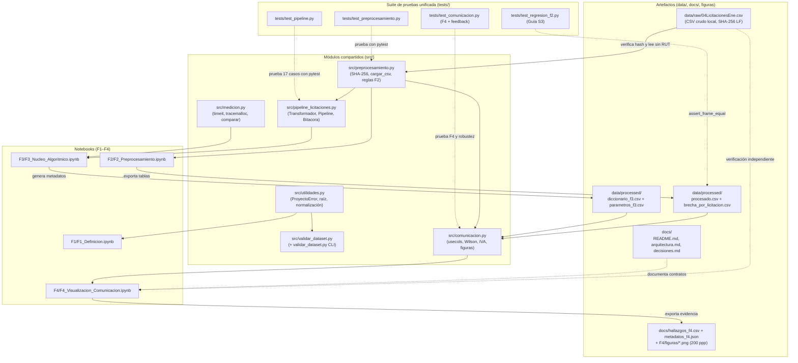
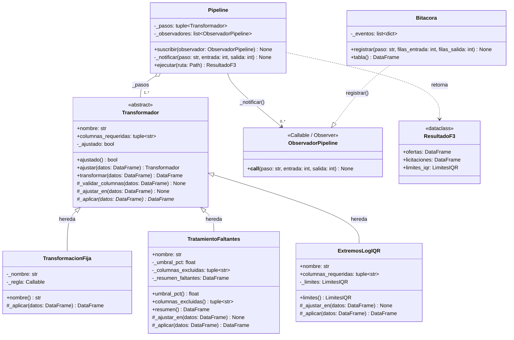

# Arquitectura del Sistema — Proyecto Grupo 2 (MCDI-500)

Este documento describe la organización estructural del proyecto **Análisis de Licitaciones Públicas en Chile (Enero 2025)**, los patrones de diseño empleados en el núcleo orientado a objetos, el análisis de escalabilidad, la evolución del código desde la Fase 2 hasta la Fase 4 y el fundamento técnico de la decisión entre recursividad y división funcional.

---

## 1. Componentes, Responsabilidades y Archivos

| Componente | Responsabilidad principal | Archivo |
| :--- | :--- | :--- |
| **Entrada CLI de validación** | Punto de entrada desde la raíz para validar datasets en línea de comandos sin duplicar lógica | [`validar_dataset.py`](../validar_dataset.py) |
| **Validador heurístico de dataset** | Perfila columnas, estima roles analíticos en crudo y verifica umbrales del curso (filas, columnas, nulos, peso MB y duplicados) | [`src/validar_dataset.py`](../src/validar_dataset.py) |
| **Utilidades transversales** | Localiza la raíz del repositorio, normaliza nombres de columnas a `snake_case` y expone la excepción de dominio `ProyectoError` | [`src/utilidades.py`](../src/utilidades.py) |
| **Reglas puras de preprocesamiento** | Funciones deterministas de F2: lectura sin identificadores (`cargar_csv`), conversión de fechas/montos, tratamiento de blancos, duplicados potenciales, escala ordinal `TamanoProveedorOrdinal`, brecha por licitación, IQR logarítmico en CLP y validación final (`validar_procesado`) | [`src/preprocesamiento.py`](../src/preprocesamiento.py) |
| **Pruebas unitarias de reglas F2** | Ejecuta casos normales, límite y de error sobre datos ficticios con pytest | [`tests/test_preprocesamiento.py`](../tests/test_preprocesamiento.py) |
| **Núcleo POO y pipeline F3** | Jerarquía de transformadores ajustables (`Transformador`, `TransformacionFija`, `TratamientoFaltantes`, `ExtremosLogIQR`), observador `Bitacora`, orquestador `Pipeline`, contenedor `ResultadoF3`, constructor `construir_pipeline()` y controles temporales (`control_iterativo`, `control_vectorizado`) | [`src/pipeline_licitaciones.py`](../src/pipeline_licitaciones.py) |
| **Instrumentación de eficiencia** | Mide tiempo mínimo con `timeit` (`medir_tiempo`), memoria pico separada con `tracemalloc` (`medir_memoria`) y compara equivalencia exacta (`comparar`) | [`src/medicion.py`](../src/medicion.py) |
| **Indicadores y gráficos F4** | Carga selectiva (`usecols`, `sep=";"`) de los cuatro artefactos procesados, calcula razón/log-razón, sentido de la brecha, medianas/IQR, intervalos de Wilson, sensibilidad de IVA/duplicados, pruebas estadísticas y genera figuras exportables (`guardar_figura`) | [`src/comunicacion.py`](../src/comunicacion.py) |
| **Pruebas del pipeline POO** | Valida clases de `pipeline_licitaciones.py` y `validar_procesado()` en `17` casos normal, límite y excepción | [`tests/test_pipeline.py`](../tests/test_pipeline.py) |
| **Regresión y equivalencia F2 (Guía S3)** | Valida equivalencia exacta con `pd.testing.assert_frame_equal` contra salidas F2 | [`tests/test_regresion_f2.py`](../tests/test_regresion_f2.py) |
| **Pruebas de F4 y robustez** | Verifica casos conocidos de F4 (`hallazgos_f4.csv`) y casos de borde del feedback (razón 1, 100 % coincidencia, categorías vacías, no-CLP, contratos rotos) | [`tests/test_comunicacion.py`](../tests/test_comunicacion.py) |
| **Definición del problema (F1)** | Formaliza problemática, objetivos, preguntas, ficha técnica de roles, pruebas de `utilidades.py` y validación del entorno | [`F1/F1_Definicion.ipynb`](../F1/F1_Definicion.ipynb) |
| **Preprocesamiento exploratorio (F2)** | Aplica y documenta las reglas de limpieza, perfilamiento, brechas e IQR generando las salidas oficiales en `data/processed/` | [`F2/F2_Preprocesamiento.ipynb`](../F2/F2_Preprocesamiento.ipynb) |
| **Núcleo algorítmico y POO (F3)** | Orquesta el pipeline POO, verifica equivalencia exacta con F2, ejecuta mediciones de eficiencia, genera diccionario/parámetros y ejecuta `ejecutar_pruebas_pipeline()` | [`F3/F3_Nucleo_Algoritmico.ipynb`](../F3/F3_Nucleo_Algoritmico.ipynb) |
| **Visualización y comunicación (F4)** | Verifica contrato con `diccionario_f3.csv` y `data/raw`, construye copia interpretable, genera las 3 figuras por objetivo (`200 ppp`), controla confusión y exporta hallazgos | [`F4/F4_Visualizacion_Comunicacion.ipynb`](../F4/F4_Visualizacion_Comunicacion.ipynb) |
| **Datos de entrada** | Fuente cruda local (`04LicitacionesEne.csv`, no versionada por privacidad) y guía de descarga pública con SHA-256 | [`data/raw/README.md`](../data/raw/README.md) |
| **Datos procesados y metadatos** | Salidas versionadas sin identificadores (`04LicitacionesEne_procesado.csv`, `04LicitacionesEne_brecha_por_licitacion.csv`) y documentación de columnas/parámetros (`diccionario_f3.csv`, `parametros_f3.csv`) | [`data/processed/README.md`](../data/processed/README.md) |
| **Documentación y hallazgos compartidos** | Diccionario completo (`README.md`), arquitectura (`arquitectura.md`), decisiones (`decisiones.md`), cifras trazables ([`hallazgos_f4.csv`](./hallazgos_f4.csv)) y metadatos ([`metadatos_f4.json`](./metadatos_f4.json)) | [`docs/README.md`](./README.md) |

---

## 2. Diagrama de Componentes y Organización por Capas

La estructura separa explícitamente los **notebooks por fase (`F1`–`F4`)**, los **módulos compartidos (`src/`)** y los **artefactos de datos y documentación (`data/`, `docs/`, `F4/figuras/`)** para evitar notebooks monolíticos o código duplicado entre fases:

1. **Reglas puras separadas de la orquestación (`preprocesamiento.py` vs. `pipeline_licitaciones.py`) y de la comunicación (`comunicacion.py`):** Las reglas de negocio de F2 son funciones deterministas que operan sobre `DataFrame` y pueden probarse de forma aislada (`tests/test_preprocesamiento.py`). La capa de F3 las envuelve en transformadores polimórficos sin duplicar lógica, y F4 delega el cálculo de indicadores (`intervalo_wilson`, `tasa_por_grupo`, razón, log-razón, medianas/IQR y resumen por tamaño) y la construcción/guardado de figuras a `src/comunicacion.py`.
2. **Cuadernos enfocados en análisis, verificación y narrativa:** `F1/`, `F2/`, `F3/` y `F4/` no almacenan copias locales de `data/` ni implementan algoritmos extensos duplicados; importan módulos desde `src/`.
3. **Privacidad por diseño desde la lectura:** `cargar_csv()` filtra los encabezados sensibles con `es_columna_privada()` antes de construir el `DataFrame` en memoria (`71` de `72` columnas leídas) y `.gitignore` impide versionar `data/raw/*.csv`.
4. **Instrumentación desacoplada:** `src/medicion.py` mide tiempo y memoria en llamadas separadas (para evitar que el sobrecosto de `tracemalloc` contamine las mediciones de tiempo) y exige igualdad exacta (`check_exact=True`) antes de reportar una optimización.

---

## 3. Patrones de Diseño y Diagrama de Clases

### 3.1. Diagrama de clases (`src/pipeline_licitaciones.py`)

El núcleo orientado a objetos unifica todos los pasos de transformación bajo el contrato común de `Transformador`, los ejecuta de forma polimórfica desde `Pipeline` y desacopla el registro de auditoría mediante el contrato observador implementado por `Bitacora`:

### 3.2. Patrón Observer (`Pipeline` y `Bitacora`)

- **Implementación:** `Pipeline` expone `suscribir(observador)` y llama internamente a `_notificar(paso, entrada, salida)` después de cargar el CSV, ejecutar cada transformador, calcular la brecha y validar las tablas finales. `Bitacora` actúa como observador concreto mediante `registrar()`, consolidando el resumen en `tabla()` con únicamente `["Paso", "Filas de entrada", "Filas de salida"]`.
- **Qué problema resuelve:**
  1. Desacopla el registro de auditoría y trazabilidad de la ejecución algorítmica del flujo de datos.
  2. Permite ejecutar el mismo `Pipeline` con cero, uno o múltiples observadores (por ejemplo, en pruebas automatizadas silenciosas frente a ejecuciones auditadas en notebooks) sin modificar la clase `Pipeline`.
  3. Preserva la privacidad: `Bitacora` registra solo conteos agregados por etapa y nunca almacena filas ni valores originales.
- **Qué pasaría sin el patrón Observer:**
  - `Pipeline.ejecutar()` tendría que mezclar lógica de transformación con `print()`, acumuladores internos de historial o dependencias directas hacia el formato de salida del cuaderno, rompiendo el principio de responsabilidad única.
  - Cada nuevo requerimiento de monitoreo (enviar logs a archivo, validar conteos en múltiples destinos o suprimir trazas en pruebas unitarias) obligaría a modificar `Pipeline.ejecutar()` mediante condicionales acoplados.

### 3.3. Otros Patrones Estructurales en `src/pipeline_licitaciones.py`

| Patrón | Dónde se aplica | Función en la arquitectura |
| :--- | :--- | :--- |
| **Template Method (Método Plantilla)** | Clase base `Transformador(ABC)` (`ajustar`, `transformar`, `_ajustar_en`, `_aplicar`) | Concentra invariantes comunes: verifica `columnas_requeridas`, entrega una copia defensiva (`datos.copy()`), controla `_ajustado` y delega únicamente el ajuste/aplicación específica a las subclases. |
| **Strategy / Polimorfismo** | Secuencia `self._pasos` en `Pipeline` (`TransformacionFija`, `TratamientoFaltantes`, `ExtremosLogIQR`) | `Pipeline.ejecutar()` recorre todos los pasos con el mismo bucle (`paso.ajustar(datos)` → `paso.transformar(datos)`), sin `if`/`isinstance` en la ejecución ni casos especiales por clase. |
| **Adapter (Adaptador)** | Clase `TransformacionFija(Transformador)` | Adapta funciones puras heredadas de F2 (`marcar_duplicados`, `convertir_tipos`, `ordenar_tamano`) al contrato `ajustar()` / `transformar()` de la jerarquía OO. |

---

## 4. Escalabilidad y Extensibilidad

1. **Crecimiento en volumen de datos:**
   - **Lectura eficiente:** Al fijar `sep=";"`, `cargar_csv()` usa el motor C de `pandas` en $O(n \cdot m)$ (evitando el motor Python), reduciendo tiempo (`4,2×`) y memoria (`4,6×`). Cuando un análisis requiere solo ciertas columnas, el uso de `usecols` reduce un `2,3×` adicional en tiempo y `4,5×` en memoria pico (`10,915 MB` frente a `48,654 MB` sobre `45.741` filas).
   - **Operaciones vectorizadas:** Los controles por fila operan sobre columnas completas en código compilado ($O(n)$ con constante mínima), lo que permite escalar linealmente sin explosión de objetos en Python. Si el horizonte crece de un mes a un año completo (~`500.000`–`1.000.000` filas), la separación entre `cargar_csv`, reglas por bloque/columna y persistencia permite adaptar la lectura por lotes (`chunksize`) manteniendo intacta la interfaz de `Pipeline`.
2. **Extensibilidad funcional:**
   - Agregar una nueva transformación con o sin estado requiere únicamente definir una subclase de `Transformador` e insertarla en `construir_pipeline()`, heredando automáticamente validación de columnas requeridas, copia defensiva y guarda de `_ajustado`.
   - Agregar un nuevo mecanismo de auditoría o métrica solo requiere suscribir una función `(str, int, int) -> None` con `pipeline.suscribir(...)`.

---

## 5. Evolución del Código desde F2 hasta F4

El diseño evolucionó de forma incremental desde prototipos en cuadernos hasta una arquitectura modular validada:

1. **Etapa inicial (F2 en cuaderno):** Las inspecciones, conversiones y cálculos exploratorios nacieron directamente en `F2/F2_Preprocesamiento.ipynb`.
2. **Extracción funcional y resguardo de privacidad (hito [`47d4589`](../src/preprocesamiento.py)):** Se retiraron datos con identificadores de proveedores del repositorio, se redujo la entrada a `72` columnas documentadas y se consolidaron reglas reutilizables en un módulo compartido (`funciones_f2_revision.py`) con pruebas sintéticas (`pruebas_f2.py`).
3. **Introducción del núcleo algorítmico F3 y medición empírica ([`ea80f40`](../F3/F3_Nucleo_Algoritmico.ipynb), [`a6dc350`](../F3/F3_Nucleo_Algoritmico.ipynb)):** Se encapsuló el flujo en `src/pipeline_licitaciones.py`, se incorporó `src/medicion.py` y, a partir de las mediciones, se adoptaron `control_vectorizado` en lugar de `control_iterativo` (`559×` más costo; este último se conserva solo como referencia para verificar el resultado) y `sep=";"` en lugar de `sep=None` (`4,2×` más costo).
4. **Alineación modular por responsabilidad ([`f1640ea`](../src/README.md)):** Se renombraron `src/preprocesamiento.py` y `src/pruebas_preprocesamiento.py` para separar utilidades de F1 (`src/utilidades.py`), reglas de F2 y pipeline de F3, además de versionar las salidas oficiales de F2 (`0c2298b`).
5. **Validación sistemática de casos normal, límite y excepción ([`1fd6e12`](../F3/F3_Nucleo_Algoritmico.ipynb), [`92cb884`](../F3/F3_Nucleo_Algoritmico.ipynb)):** Se añadió `ejecutar_pruebas_pipeline()` en la Sección 7 de `F3_Nucleo_Algoritmico.ipynb` verificando escenarios reales y sintéticos (`1` sola fila, `0` ofertas CLP, columnas sin nulos, errores de esquema y archivo inexistente).
6. **Consolidación POO con herencia real y ajuste uniforme ([`23f3a5a`](../src/pipeline_licitaciones.py)):** Se concentró en `Transformador` el control de `_ajustado`, la validación de `columnas_requeridas` y la copia defensiva; `TratamientoFaltantes` pasó a ser transformador ajustable (aprende columnas `> 90 %` y las excluye al aplicar); y `ExtremosLogIQR` ingresó a la secuencia única de pasos de `Pipeline`, preservando equivalencia exacta (`check_exact=True`) con las dos salidas de F2.
7. **Extracción de indicadores y gráficos de F4 en [`src/comunicacion.py`](../src/comunicacion.py):** Se consolidó la lectura selectiva con `usecols` y `sep=";"` de los cuatro artefactos de `data/processed/` (`cargar_artefactos`), sin `revertir_escalamiento` ni `reconstruir_categorias` por no aplicar al pipeline sin escalamiento, junto con `intervalo_wilson`, `tasa_por_grupo`, `guardar_figura` y los indicadores de razón, log-razón, sentido, medianas/IQR y resumen por tamaño ganador para que `F4` solo invoque funciones probadas del módulo.
8. **Unificación y profesionalización de pruebas en `tests/` con `pytest`:** Se migraron las pruebas de reglas y de clases POO hacia `tests/` (`test_preprocesamiento.py` y `test_pipeline.py`), incorporando pruebas de regresión contra F2 con `pd.testing.assert_frame_equal` (Guía S3 en `test_regresion_f2.py`) y validaciones de robustez en `test_comunicacion.py` (razón exacta 1, 100 % de coincidencia, categorías de tamaño vacías, exclusión de monedas no CLP, artefactos ausentes, Wilson con 0 éxitos o grupos vacíos y contratos rotos), permitiendo ejecutar las 36 pruebas con el comando estándar `pytest`.

---

## 6. Recursividad o división funcional

Como decisión de diseño de la arquitectura del núcleo (**decisión 0.5**), el proyecto descarta la recursividad para recorrer registros y adopta **división funcional con operaciones vectorizadas por columna e iteración acotada sobre pasos**:

1. **Estructura plana sin anidamiento:** El conjunto de datos (`04LicitacionesEne.csv`) es una tabla rectangular plana de **`45.741` filas × `72` columnas** (`71` al leer sin identificadores directos), donde cada fila representa una oferta por ítem dentro de una licitación. No existen árboles ni documentos JSON/XML de profundidad variable que requieran descenso recursivo.
2. **Reglas vectorizadas por columna frente al límite de pila de Python:** Python fija por defecto un límite de profundidad de recursión cercano a **`1.000` llamadas** (`sys.getrecursionlimit()`). Un recorrido recursivo fila a fila sobre `45.741` ofertas superaría en más de `45` veces ese límite, provocando `RecursionError` inmediato y creando decenas de miles de marcos de pila innecesarios. En contraste, las reglas columnares en `src/preprocesamiento.py` y `control_vectorizado()` en `src/pipeline_licitaciones.py` ejecutan comparaciones contiguas en C ($O(n)$) sin consumir marcos de pila por fila, mientras `Pipeline.ejecutar()` itera únicamente sobre una lista corta y fija de `5` pasos (`Transformador`).
3. **Cuándo sí se usaría recursión:** Sería adecuada únicamente si el dominio involucrara estructuras jerárquicas de profundidad variable o desconocida a priori, por ejemplo: recorrer un árbol taxonómico UNSPSC de niveles arbitrarios, aplanar respuestas anidadas de la API de Mercado Público con subítems variables o explorar componentes conexas en grafos de relaciones entre proveedores.
4. **Evidencia empírica en F3:** En la **Sección 4.2** de [`F3/F3_Nucleo_Algoritmico.ipynb`](../F3/F3_Nucleo_Algoritmico.ipynb) (celdas `f3-memoria-code` y `f3-memoria-interpretacion`), al comparar sobre las `45.741` filas reales (`7` repeticiones):
   - **`control_vectorizado`** registró **`0,144 ms`** de tiempo mínimo y **`0,224 MB`** de memoria pico.
   - **`control_iterativo`** registró **`80,395 ms`** y **`4,003 MB`** de memoria pico.
   - Ambos entregaron exactamente las mismas `0` alertas, pero la alternativa columnar vectorizada resultó **`559` veces más rápida y consumió `18` veces menos memoria pico**. Con `900` filas, bajo el límite de recursión, `suma_recursiva()` fue `11` veces más lenta que la suma vectorizada (sección 9).
